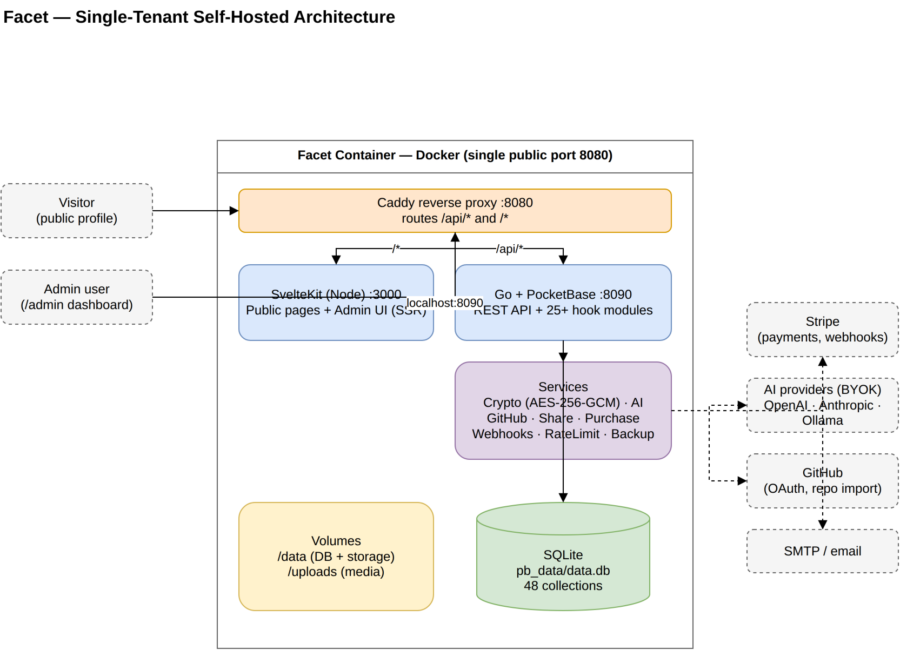

# Architecture

How a running Facet is put together. This is for contributors, and for owners who like to know what's under the bonnet. For the reasoning behind the design, see [Design principles](DESIGN.md).

Editable sources for this and the data-model diagram are in [diagrams](diagrams/README.md).

## The stack

| Layer | Technology | Where |
|-------|------------|-------|
| Backend | Go 1.27, [PocketBase](https://pocketbase.io/) 0.40 as a Go framework, SQLite | [`backend/`](../backend) |
| Frontend | SvelteKit 3, Svelte 5, TypeScript, Tailwind CSS 3, Vite 8, adapter-node on Node.js 24 | [`frontend/`](../frontend) |
| Proxy | Caddy, built from [`docker/caddy`](../docker/caddy) with the same Go toolchain | [`docker/Caddyfile`](../docker/Caddyfile) |
| Packaging | One multi-stage Docker image for `linux/amd64` and `linux/arm64` | [`docker/Dockerfile`](../docker/Dockerfile) |
| Document conversion | Pandoc and LaTeX (AI résumés), `heif-convert` (HEIC images) | runtime image |

Exact versions are in [`backend/go.mod`](../backend/go.mod), [`frontend/package.json`](../frontend/package.json) and [`.nvmrc`](../.nvmrc).

## Inside the container

[`docker/start.sh`](../docker/start.sh) runs as root just long enough to apply `PUID`/`PGID` and fix ownership of `/app`, `/data` and `/uploads`, then switches to the `facet` user and:

1. works out the encryption key ([lookup order](SETUP.md#the-encryption-key))
2. makes `/data/storage` a link to `/uploads`, moving files from older layouts if needed
3. starts PocketBase: `./facet serve --http=127.0.0.1:8090 --dir=/data`
4. waits up to `FACET_HEALTH_TIMEOUT` seconds (default 30) for `/api/health`, and stops with `[Startup] Facet did not start` if the backend exits or never answers
5. starts SvelteKit: `node build/index.js` on port 3000
6. starts Caddy on port 8080 and waits the same time for `http://127.0.0.1:8080/health`, the URL the image's `HEALTHCHECK` uses, so a request has to pass through Caddy to SvelteKit before the script prints "Facet is running!"

If any of the three processes exits, the script stops the others and exits with a non-zero status, so Docker's restart policy sees a failure instead of a half-running container. On `docker stop`, or any other exit, it sends SIGTERM to its own three child processes only, gives them up to `FACET_SHUTDOWN_TIMEOUT` seconds (default 10) to finish, then sends SIGKILL to any that are left. Docker's own stop timeout is also 10 seconds by default, so if you raise `FACET_SHUTDOWN_TIMEOUT`, raise `stop_grace_period` in Compose to match.

## Request routing

Caddy is the only listener exposed. It routes by path ([Caddyfile](../docker/Caddyfile)):

| Path | Goes to | Notes |
|------|---------|-------|
| `/api/files/*` | PocketBase | Uploaded files, cached for a day |
| `/api/*` | PocketBase | Not cached. Caddy strips any incoming `X-Internal` header. |
| `/rss.xml`, `/talks.ics` | PocketBase | Feeds |
| `/_/*` | PocketBase | Only when `ADMIN_ENABLED=true`, otherwise 404 |
| `/_app/immutable/*` | SvelteKit | Hashed assets, cached for a year |
| `/CHANGELOG.md`, `/LATEST_VERSION` | SvelteKit | Not cached |
| everything else | SvelteKit | Pages, `/health`, `/sitemap.xml`, `/robots.txt` |

Caddy also adds the security headers and enforces a 25 MB request body limit ([Security](SECURITY.md#response-headers)).

### A page request

When someone opens `/recruiter`:

1. Caddy passes the request to SvelteKit.
2. The `[slug=slug]` route checks the slug isn't reserved ([`params.ts`](../frontend/src/params.ts)).
3. Its server load function calls PocketBase directly at `POCKETBASE_URL` (`http://localhost:8090`), forwarding any share-link cookie as an `X-Share-Token` header or a password token as a bearer token. These server-side calls set `X-Internal: true`, which exempts them from rate limiting and changes how view counts are recorded. They don't go through Caddy, so a visitor can't forge that header on `/api/*`.
4. PocketBase's `/api/view/{slug}/access` and `/api/view/{slug}/data` decide what the visitor may see and return it.
5. SvelteKit renders the HTML. In the browser, Svelte takes over and later API calls go to `/api/...` through Caddy.

## Backend

[`backend/main.go`](../backend/main.go) creates the PocketBase app, refuses to start without a valid `ENCRYPTION_KEY`, builds the shared services, registers every hook, and adds CLI commands (`demo`, `reset-2fa`, `reset-admin-password`) alongside PocketBase's own (`serve`, `superuser`, `migrate`).

| Folder | What's in it |
|--------|--------------|
| [`hooks/`](../backend/hooks) | One file per feature. Each registers routes on `OnServe` and record hooks: views, sharing, auth, AI, media, newsletter, comments, payments, API keys, webhooks, backups and more. |
| [`services/`](../backend/services) | Reusable logic: encryption, rate limiting, AI providers, GitHub, email, storage, thumbnails, webhooks dispatch, backups, cleanup, plan flags |
| [`services/mediaembed/`](../backend/services/mediaembed) | Recognising embeddable media URLs and oEmbed lookups |
| [`migrations/`](../backend/migrations) | Schema changes in Go, applied automatically at startup (`Automigrate: true`) |
| [`seeds/demo_assets/`](../backend/seeds) | Images for demo mode, copied into the image |
| [`buildinfo/`](../backend/buildinfo) | Version, commit and build date set at build time |
| [`internal/textlimit/`](../backend/internal/textlimit) | UTF-8-safe truncation |

### Access control model

- At startup, [`rules.go`](../backend/hooks/rules.go) sets the content and sensitive collections so that direct PocketBase record access needs a signed-in user. Later migrations lock newer collections in the same way, or to backend-only.
- Public data never comes from raw collection endpoints. Custom endpoints read with server authority and apply visibility, draft and share-link rules in code.
- Any signed-in `users` account counts as the owner. `ADMIN_EMAILS` limits who can sign in ([Security](SECURITY.md#who-can-sign-in)).

### Background work

All in-process goroutines, so nothing extra to run:

| Job | When |
|-----|------|
| Database backup | Daily at `BACKUP_HOUR` UTC ([backup.go](../backend/hooks/backup.go)) |
| Cleanup of expired tokens, failed exports and unreferenced uploads | 30 seconds after start, then every 24 hours ([cleanup.go](../backend/hooks/cleanup.go)) |
| Webhook delivery | 4 workers with an in-memory queue and retries ([webhooks.go](../backend/services/webhooks.go)) |
| Newsletter sending | Background sends, up to 4 at once ([newsletter_concurrency.go](../backend/hooks/newsletter_concurrency.go)) |
| View counts and access logs | Written asynchronously per request |
| Rich-text content repair | Once, at startup ([content_recovery.go](../backend/hooks/content_recovery.go)) |

### Data on disk

With `--dir=/data`, PocketBase keeps its SQLite databases (`data.db` for content, `auxiliary.db` for its logs) directly in `/data`. Uploaded files live in `/data/storage`, which `start.sh` links to `/uploads`. Built-in backups go to `/data/backups`.

## Data model

There are around fifty collections. The main groups:

| Group | Collections |
|-------|-------------|
| Profile and content | `profile`, `experience`, `projects`, `education`, `certifications`, `awards`, `skills`, `posts`, `talks`, `custom_content`, `contact_methods` |
| Presentation | `views`, `share_tokens`, `site_settings`, `view_exports` |
| Media | `uploads`, `external_media`, plus file fields on content records |
| Testimonials | `testimonials`, `testimonial_requests`, `email_verification_tokens` |
| Audience | `comments`, comment reports, `subscribers`, newsletter lists and sends |
| Commerce and courses | pricing fields, coupons, purchases, downloads, courses, modules, lessons, quizzes, certificates |
| Integrations | `ai_providers`, `sources`, `import_proposals`, `settings`, `api_keys`, `webhooks`, webhook deliveries |
| Operations | `audit_logs`, `access_logs`, `system_alerts` |
| Demo | `demo_*` copies of the content collections |
| Accounts | `users` (PocketBase auth collection) |

Field-level detail lives in the migrations. The [data-model diagram](diagrams/facet-data-model.png) shows the core relationships.

### Views

A view stores its configuration in a `sections` JSON field: which sections appear, their order and layout, which items are selected, and per-item overrides. Hero text, call to action, accent colour and visibility are ordinary fields on the view. Some content (contact methods, testimonials) also has a `view_visibility` map so individual items can be hidden from particular views.

### Demo mode

`demo_*` collections mirror the content collections. While demo data exists, `getTableName()` in [`view.go`](../backend/hooks/view.go) sends public reads to the demo tables instead, which is why the public site shows the demo while it's on.

## Frontend

| Folder | What's in it |
|--------|--------------|
| [`src/routes/`](../frontend/src/routes) | Public pages (`/`, `/[slug=slug]`, `/s/[token]`, `/v/[slug]`, `/posts`, `/projects/[slug]`, `/talks`, `/testimonial/...`) and the admin (`/admin/...`) |
| [`src/routes/health`](../frontend/src/routes/health), `sitemap.xml`, `robots.txt`, `manifest.webmanifest` | Operational routes |
| [`src/components/`](../frontend/src/components) | `public/`, `admin/` and `shared/` components |
| [`src/lib/`](../frontend/src/lib) | PocketBase client, stores, i18n, view editor, experiences, SEO helpers, server helpers |
| [`src/locales/`](../frontend/src/locales) | Translation files |
| [`src/params.ts`](../frontend/src/params.ts) | The slug matcher and reserved words |
| [`src/hooks.server.ts`](../frontend/src/hooks.server.ts) | Server-side request handling |
| [`static/`](../frontend/static) | Files served as-is, such as the favicon and icon |
| [`tests/`](../frontend/tests) | Playwright browser tests |

SvelteKit's configuration is in [`vite.config.ts`](../frontend/vite.config.ts). In development, Vite proxies `/api` and `/_` to `http://localhost:8090`.

## Development layout

Native development (`make dev`) runs the same two application processes without Caddy or Docker, both on loopback: PocketBase at `127.0.0.1:8090` (rebuilt by Air when Go files change) and Vite at `127.0.0.1:5173` with hot reload. Data lives in `pb_data/` in the checkout. [Development guide](DEV.md) has the details.
